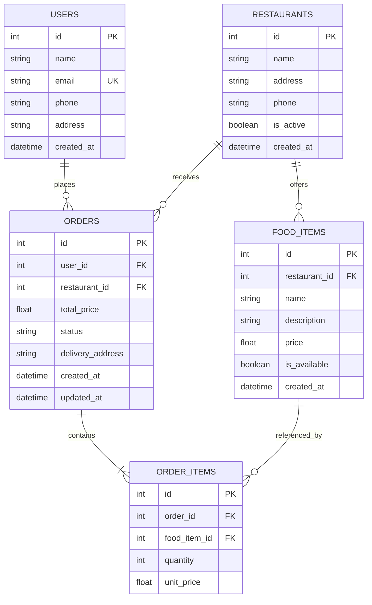

# Food Order API

A clean, modular, and production-ready RESTful Food Ordering API built with **FastAPI**, **SQLAlchemy 2.0**, and **Pydantic v2**.

---

## 📌 Project Overview

The **Food Order API** enables customer management, restaurant onboarding, menu item management, and end-to-end food order lifecycle processing (ordering, status tracking, price calculation, and cancellation) with strict business rule validation.

---

## 🛠️ Technologies Used

- **Python 3.10+** - Core programming language
- **FastAPI** - High-performance modern web framework for building APIs
- **Uvicorn** - Lightning-fast ASGI web server implementation
- **SQLAlchemy 2.0** - Object-Relational Mapping (ORM) and database toolkit
- **Pydantic v2** - Data validation and settings management using Python type annotations
- **python-dotenv** - Environment variable management
- **SQLite** - Relational database (easily swapped with PostgreSQL / MySQL via `.env`)

---

## 🏗️ Architecture

The application follows a **Modular Layered Architecture** ensuring clear separation of concerns, high maintainability, and testability:

```
┌─────────────────────────────────────────────────────────┐
│                      Client Requests                    │
└────────────────────────────┬────────────────────────────┘
                             │
                             ▼
┌─────────────────────────────────────────────────────────┐
│                  Routes Layer (app/routes)              │
│       - HTTP Endpoints, Request/Response Handling       │
└────────────────────────────┬────────────────────────────┘
                             │
                             ▼
┌─────────────────────────────────────────────────────────┐
│                 Services Layer (app/services)           │
│       - Business Logic, Validations, Price Calculation  │
└────────────────────────────┬────────────────────────────┘
                             │
                             ▼
┌─────────────────────────────────────────────────────────┐
│            Data Access Layer (app/models & database)    │
│       - SQLAlchemy ORM Models, Sessions, SQLite DB      │
└─────────────────────────────────────────────────────────┘
```

- **Config Layer (`app/config/`)**: Centralized application configuration and `.env` loading.
- **Database Layer (`app/database/`)**: Declarative base, engine setup, and session dependency (`get_db`).
- **Models Layer (`app/models/`)**: SQLAlchemy ORM models defining database tables and relational integrity.
- **Schemas Layer (`app/schemas/`)**: Pydantic models for request payload validation and response serialization.
- **Services Layer (`app/services/`)**: Core business rules, transactional database operations, and data transformations.
- **Routes Layer (`app/routes/`)**: FastAPI `APIRouter` modules exposing RESTful endpoints.

---

## 📁 Folder Structure

```
Food order API/
│
├── app/
│   ├── __init__.py
│   ├── main.py                  # Application entry point, lifespan, router inclusion
│   │
│   ├── config/                  # Configuration & Environment
│   │   ├── __init__.py
│   │   └── settings.py          # Settings class and .env loading
│   │
│   ├── database/                # Database setup & session management
│   │   ├── __init__.py
│   │   ├── base.py              # SQLAlchemy DeclarativeBase
│   │   └── connection.py        # Engine, SessionLocal, get_db dependency
│   │
│   ├── models/                  # SQLAlchemy ORM database models
│   │   ├── __init__.py
│   │   ├── user.py              # User model
│   │   ├── restaurant.py        # Restaurant model
│   │   ├── food_item.py         # FoodItem model
│   │   ├── order.py             # Order model
│   │   └── order_item.py        # OrderItem (association/items) model
│   │
│   ├── schemas/                 # Pydantic validation schemas
│   │   ├── __init__.py
│   │   ├── user.py              # User request/response schemas
│   │   ├── restaurant.py        # Restaurant request/response schemas
│   │   ├── food_item.py         # FoodItem request/response schemas
│   │   ├── order.py             # Order request/response schemas & OrderStatus enum
│   │   └── order_item.py        # OrderItem request/response schemas
│   │
│   ├── services/                # Business logic & operations
│   │   ├── __init__.py
│   │   ├── user_service.py      # User CRUD & uniqueness checks
│   │   ├── restaurant_service.py# Restaurant CRUD & filtering
│   │   ├── food_service.py      # FoodItem CRUD & restaurant association
│   │   └── order_service.py     # Order placement, price calculation, lifecycle
│   │
│   └── routes/                  # API Route Controllers
│       ├── __init__.py
│       ├── users.py             # /api/v1/users endpoints
│       ├── restaurants.py       # /api/v1/restaurants endpoints
│       ├── foods.py             # /api/v1/foods endpoints
│       └── orders.py            # /api/v1/orders endpoints
│
├── tests/                       # Automated unit & integration tests
│   ├── __init__.py
│   └── test_api.py              # Comprehensive test suite (FastAPI TestClient)
│
├── scratch/                     # Database seed & utility scripts
│   └── seed_demo_data.py        # Demo restaurant & menu seeder
│
├── .env                         # Local environment configuration
├── .env.example                 # Example environment variables template
├── .gitignore                   # Git ignore patterns
├── food_order.db                # SQLite database file
├── README.md                    # Project documentation
└── requirements.txt             # Project dependencies
```

---

## 🗄️ Database Entities & Relationships




### Key Relational Rules:
- **Users**: Unique email constraint. Deleting a user cascade-deletes their orders.
- **Restaurants**: Deleting a restaurant cascade-deletes its menu items and orders.
- **Food Items**: Linked to a specific restaurant. Must be active/available to be ordered.
- **Orders**: Locks the calculated total price and captures historical item prices in `OrderItems` at checkout time.
- **Order Statuses**: `Pending` ➔ `Confirmed` ➔ `Preparing` ➔ `Out for Delivery` ➔ `Delivered` (or `Cancelled`).

---

## 🚀 API Endpoints

### 🩺 Health & Info
| Method | Endpoint | Description |
| :--- | :--- | :--- |
| `GET` | `/health` | Server health check and status |
| `GET` | `/` | API welcome message and documentation links |

### 👤 Users (`/api/v1/users`)
| Method | Endpoint | Description |
| :--- | :--- | :--- |
| `POST` | `/api/v1/users/` | Create a new user account |
| `GET` | `/api/v1/users/` | List all users (supports `skip`, `limit` pagination) |
| `GET` | `/api/v1/users/{user_id}` | Get user details by ID |
| `PUT` | `/api/v1/users/{user_id}` | Update existing user details |
| `DELETE` | `/api/v1/users/{user_id}` | Delete user by ID |

### 🍽️ Restaurants (`/api/v1/restaurants`)
| Method | Endpoint | Description |
| :--- | :--- | :--- |
| `POST` | `/api/v1/restaurants/` | Register a new restaurant |
| `GET` | `/api/v1/restaurants/` | List all restaurants (supports `active_only`, `skip`, `limit`) |
| `GET` | `/api/v1/restaurants/{restaurant_id}` | Get restaurant by ID |
| `PUT` | `/api/v1/restaurants/{restaurant_id}` | Update restaurant details |
| `DELETE` | `/api/v1/restaurants/{restaurant_id}` | Delete restaurant by ID |
| `POST` | `/api/v1/restaurants/{restaurant_id}/foods/` | Add a food item directly to a restaurant |

### 🍕 Food Items (`/api/v1/foods`)
| Method | Endpoint | Description |
| :--- | :--- | :--- |
| `POST` | `/api/v1/foods/` | Create a new food item (requires `restaurant_id`) |
| `GET` | `/api/v1/foods/` | List food items (supports `restaurant_id`, `available_only`, `skip`, `limit`) |
| `GET` | `/api/v1/foods/{food_id}` | Get food item details by ID |
| `PUT` | `/api/v1/foods/{food_id}` | Update food item details |
| `DELETE` | `/api/v1/foods/{food_id}` | Delete food item by ID |

### 📦 Orders (`/api/v1/orders`)
| Method | Endpoint | Description |
| :--- | :--- | :--- |
| `POST` | `/api/v1/orders/` | Place a new order with items |
| `GET` | `/api/v1/orders/` | List orders (supports `user_id`, `restaurant_id`, `order_status`, `skip`, `limit`) |
| `GET` | `/api/v1/orders/{order_id}` | Get full order details and items by ID |
| `PATCH` | `/api/v1/orders/{order_id}/status` | Update order status (`Pending`, `Confirmed`, etc.) |
| `PATCH` | `/api/v1/orders/{order_id}/cancel` | Cancel an active order |

---

## ⚙️ Installation & Setup

### 1. Clone or Open the Repository
```bash
cd "Food order API"
```

### 2. Create and Activate a Virtual Environment
- **Windows (PowerShell):**
  ```powershell
  python -m venv venv
  .\venv\Scripts\Activate.ps1
  ```
- **macOS / Linux:**
  ```bash
  python3 -m venv venv
  source venv/bin/activate
  ```

### 3. Install Dependencies
```bash
pip install -r requirements.txt
```

### 4. Configure Environment Variables
Copy `.env.example` to `.env` (or edit existing `.env`):
```ini
APP_NAME="Food Order API"
APP_ENV="development"
DEBUG=True
HOST=127.0.0.1
PORT=8000
DATABASE_URL=sqlite:///./food_order.db
```

---

## ▶️ Running the Server

Start the development server with hot-reload enabled:

```bash
uvicorn app.main:app --reload --host 127.0.0.1 --port 8000
```

Or run directly with Python:
```bash
python -m app.main
```

---

## 🧪 Running Automated Tests

Run the test suite using Python's built-in `unittest` runner:

```bash
python -m unittest tests/test_api.py
```

---

## 🌱 Seeding Demo Data

Populate the database with demo restaurants and menu items:

```bash
python scratch/seed_demo_data.py
```


---

## 📖 Interactive Documentation

Once the server is running, you can explore and execute all API endpoints directly in your browser:

- **Swagger UI (Interactive):** [http://127.0.0.1:8000/docs](http://127.0.0.1:8000/docs)
- **ReDoc (Alternative Docs):** [http://127.0.0.1:8000/redoc](http://127.0.0.1:8000/redoc)

---

## 🔄 Example API Flow

Follow this sequential workflow to test the full lifecycle of the food ordering system:

### 1. Create a User
**`POST /api/v1/users/`**
```json
{
  "name": "Jane Doe",
  "email": "jane.doe@example.com",
  "phone": "+1-555-0199",
  "address": "123 Main Street, Suite 400"
}
```
*Response returns created User with `id: 1`.*

---

### 2. Create a Restaurant
**`POST /api/v1/restaurants/`**
```json
{
  "name": "Pizza Bella",
  "address": "456 Italian Way",
  "phone": "+1-555-0288",
  "is_active": true
}
```
*Response returns created Restaurant with `id: 1`.*

---

### 3. Add Food Items to Restaurant
**`POST /api/v1/restaurants/1/foods/`**
```json
{
  "name": "Margherita Pizza",
  "description": "Fresh mozzarella, tomato sauce, and basil",
  "price": 12.99,
  "is_available": true
}
```
*Response returns created FoodItem with `id: 1`.*

**`POST /api/v1/restaurants/1/foods/`**
```json
{
  "name": "Garlic Bread",
  "description": "Crispy toasted bread with garlic herb butter",
  "price": 4.50,
  "is_available": true
}
```
*Response returns created FoodItem with `id: 2`.*

---

### 4. Place an Order
**`POST /api/v1/orders/`**
```json
{
  "user_id": 1,
  "restaurant_id": 1,
  "delivery_address": "123 Main Street, Suite 400",
  "items": [
    {
      "food_item_id": 1,
      "quantity": 2
    },
    {
      "food_item_id": 2,
      "quantity": 1
    }
  ]
}
```
*The API validates all items, locks unit prices ($12.99 * 2 + $4.50 = $30.48), creates the order with status `Pending`, and returns the order details.*

---

### 5. View Order Details
**`GET /api/v1/orders/1`**
*Returns full order breakdown including list of items, unit prices, user ID, restaurant ID, and current status.*

---

### 6. Update Order Status (Restaurant/Delivery Workflow)
**`PATCH /api/v1/orders/1/status`**
```json
{
  "status": "Preparing"
}
```
*Available statuses: `Pending` ➔ `Confirmed` ➔ `Preparing` ➔ `Out for Delivery` ➔ `Delivered`.*

---

### 7. Cancel Order (Optional)
**`PATCH /api/v1/orders/1/cancel`**
*Cancels the order if it has not already been delivered.*
